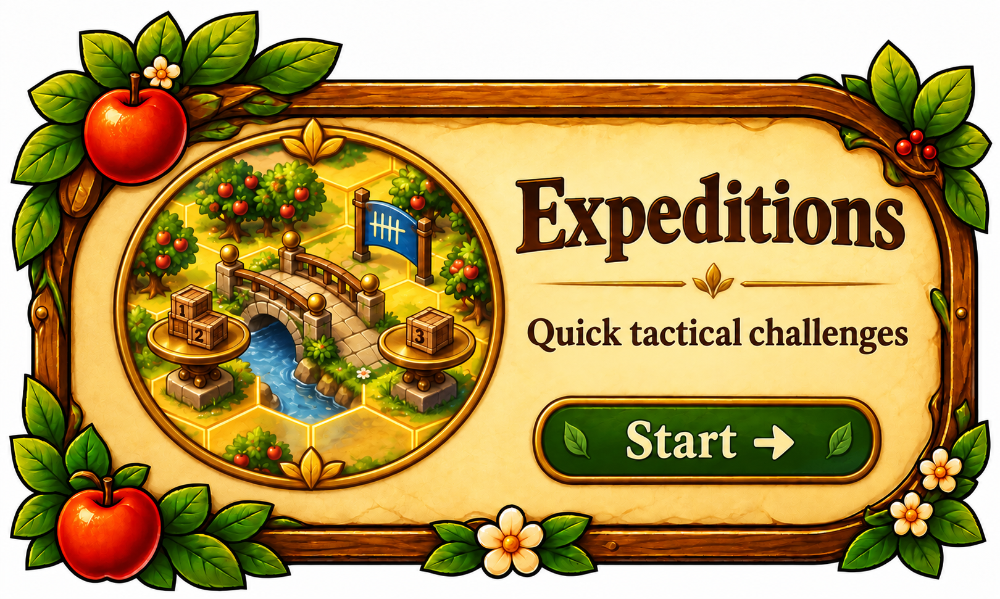
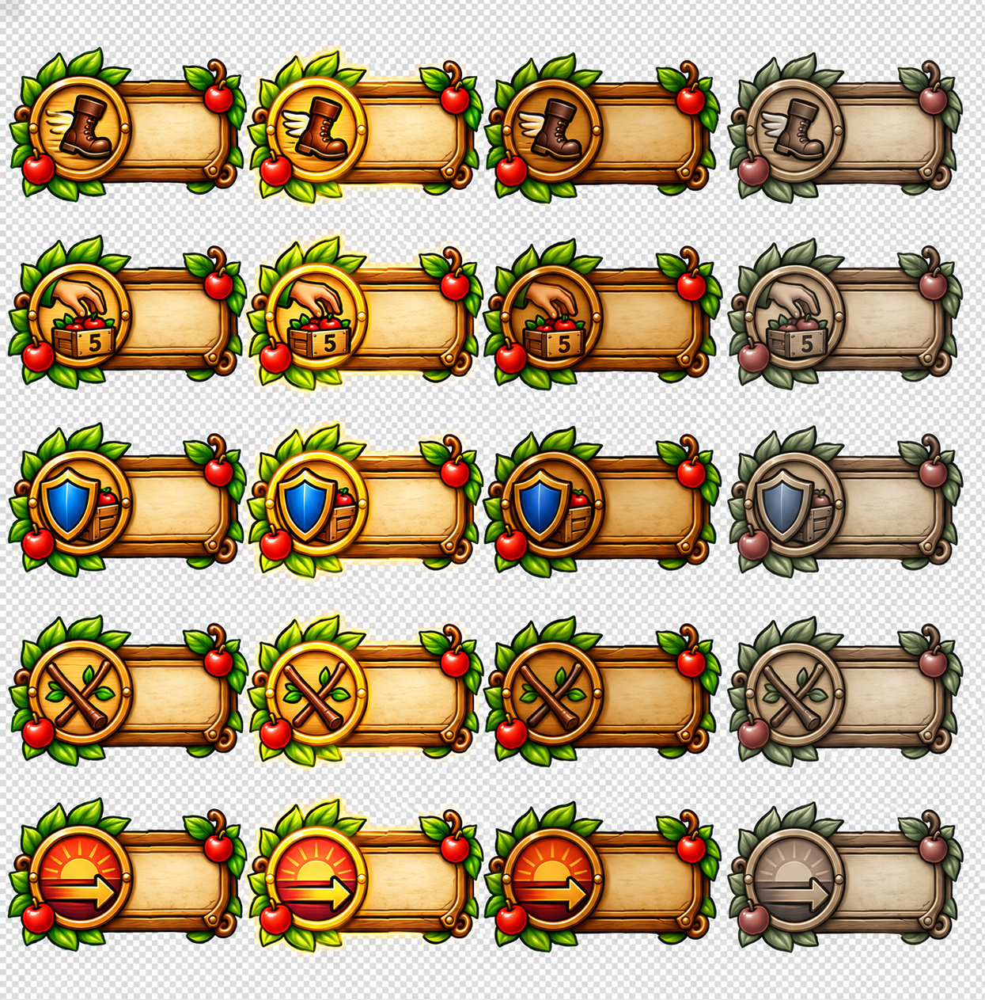
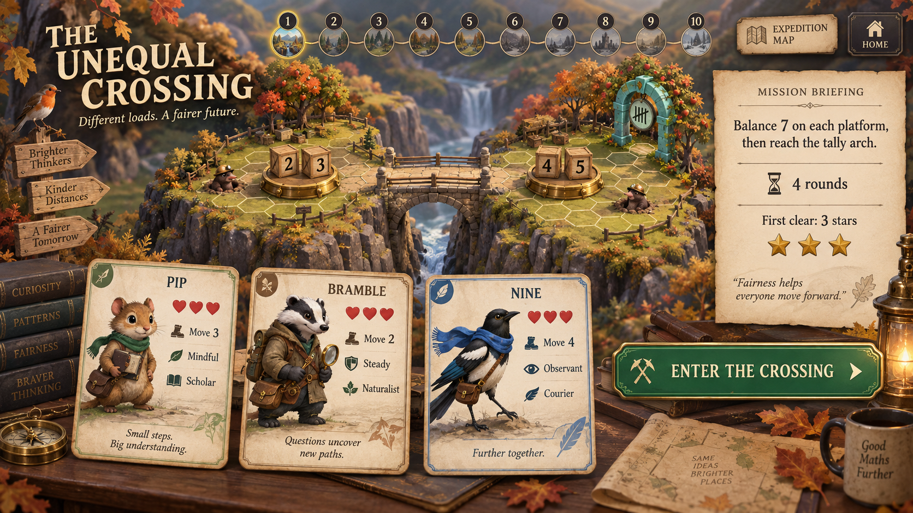
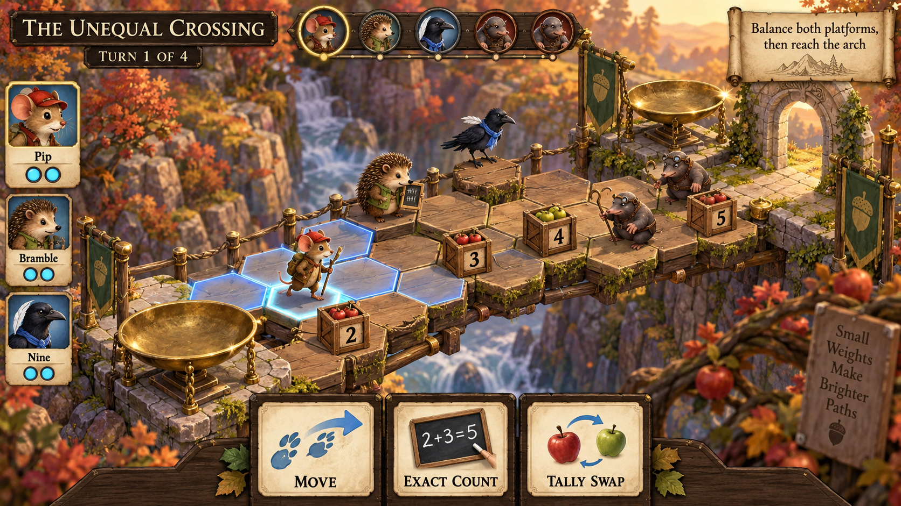
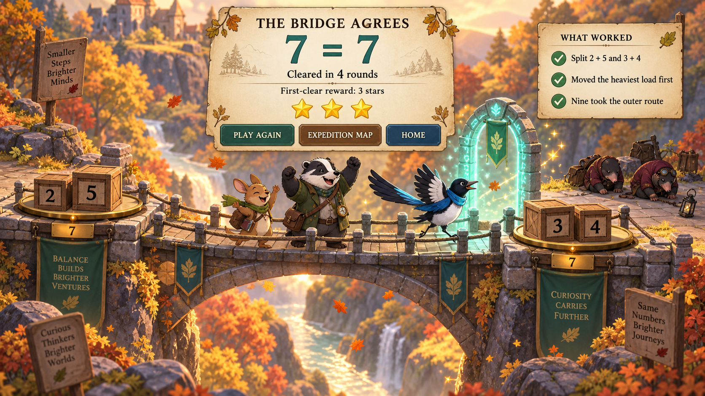
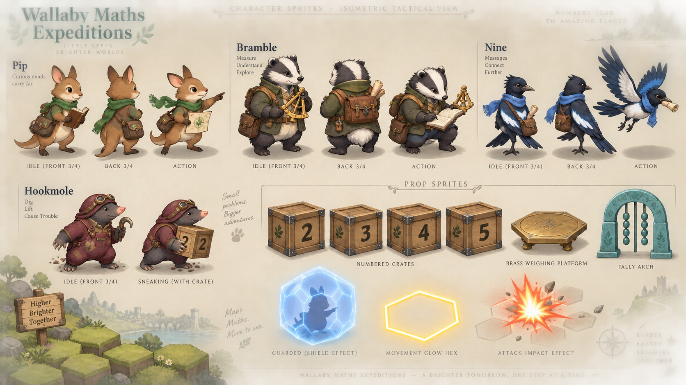

# The Unequal Crossing: artistic mock-ups

> Central entry point: `EXPEDITIONS_MASTER_BRIEF.md`. These are visual references. The current
> acceptance requirements are in `EXPEDITIONS_VISUAL_ACCEPTANCE.md`.

## Ninefold Orchard entry tile

This replaces the generic beige draft as the visual target. It uses the module's existing carved timber frame and the concise subtitle "Quick tactical challenges". It is not yet connected to the app.

## Ninefold Orchard tactical controls

The sheet defines five core actions across four interaction states. Final controls will use live text, semantic buttons and responsive hit areas over production-ready sliced artwork. This is an art-direction asset, not an implemented control set.

## 1. Mission briefing and squad selection

The player sees the mathematical rule before choosing a squad. The map preview exposes both platforms, all four values, the exit and the enemies. The card panels translate collection stats into field capabilities without introducing character-specific decks.

## 2. The tactical board

The board is the centre of attention. Glowing hexes show legal movement, numbered props carry the mathematics into the scene and the Hookmoles declare their intention. Squad state remains on the left and objective, totals and actions remain on the right. The implementation uses this composition with simpler portrait stand-ins until extracted field sprites are ready.

## 3. Objective resolution

Victory explains the solution instead of showing only confetti. It confirms the equality, the turn count, the one-time reward and three strategic ideas the child can carry into a replay.

## Sprite and prop direction

This sheet establishes the minimum pose set, common ground shadow, silhouettes, field props and shared effects. These are painted sprites placed and animated in a faux-3D scene, not polygonal models.
